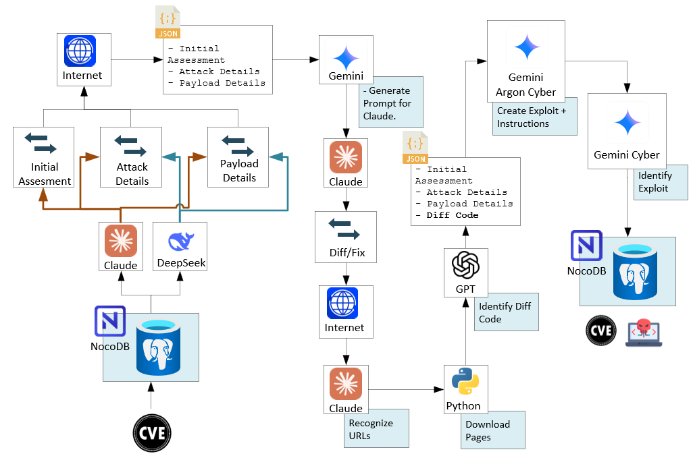
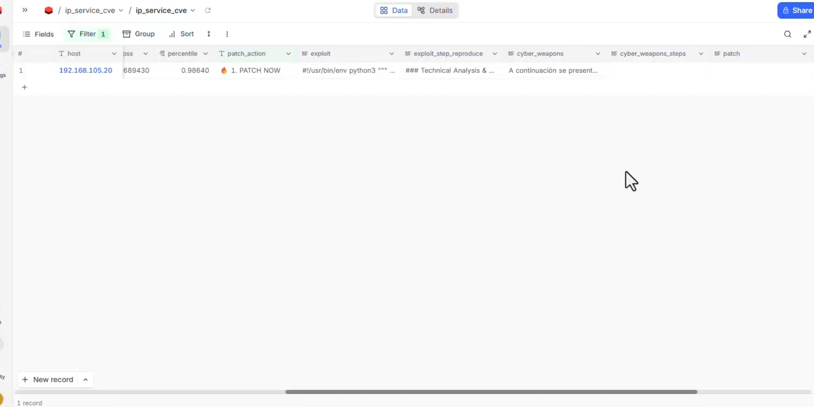
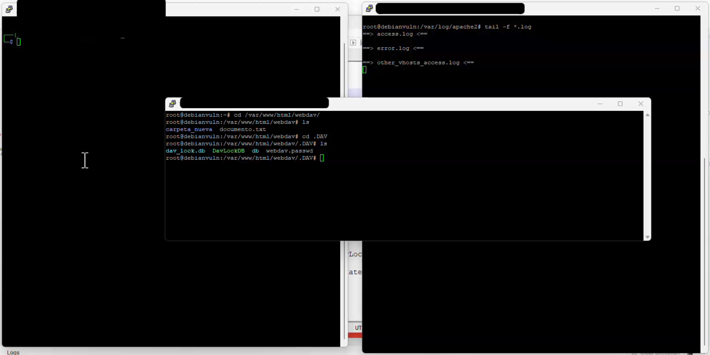
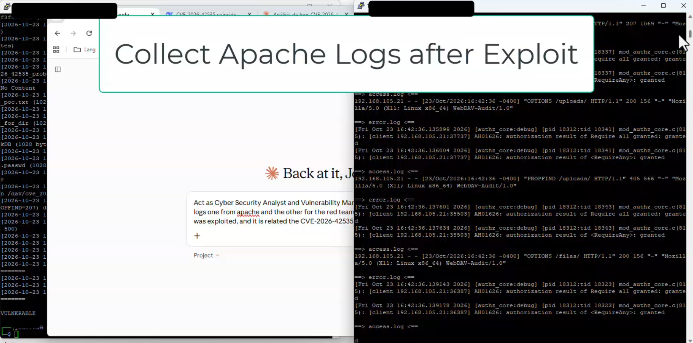

# 🛡️🔍 SPF: CVE Description to 3xplo1t

This document outlines how to utilize the **Symbolic Prompting Framework (SPF)** plus **Normal Prompt** that based on CVE detected in one solution. The AI goes to the internet and collect CVE Technical Description and generates a PoC-Exploit.

This process is intended **strictly for cybersecurity research and defensive analysis.**

> [!IMPORTANT]
> **Core Concept:** By using symbolic logic, we can map flat data structures directly into precise technical objects. This approach eliminates unnecessary conversational filler and ensures that the output remains consistent and reliable for Blue Team and Purple Team automation workflows.


<div align="center">

[](https://github.com/mindhack03d/SymbolicPrompting)
[](https://youtube.com/playlist?list=PLNFL-2KY9QZVqoRwRzVLPN6qmDftpsjg6)
[](https://www.youtube.com/playlist?list=PLNFL-2KY9QZXhGEfGUOrrZtzGdPESwh4l)
[](https://youtube.com/playlist?list=PLNFL-2KY9QZUKlXC_4gnVUHoAJdd4s-AC&si=4N7ROWCD3G46y8t5l)
[](https://opensource.org/licenses/MIT)
[](../Benchmark/symbolic_support_test.md)
[](../SECURITY.md)

[](../README.md) | [](../examples/symbolic_prompting_library.md)

</div>

---

## 🔒 GitHub Compliance & Responsible Use

**Nature of this repository:**
This repository contains **prompt templates** that instruct LLMs to analyze CVEs
and, in later stages, to generate verification scripts. Some prompts (6–8) can
produce code that performs active requests against a target. This is **dual-use
content**: it is published for defensive research, but it can be misused.

**What this repository does NOT contain:**
- ❌ No pre-built exploit binaries or ready-to-run attack tools
- ❌ No malware, no C2 infrastructure, no credential stealers
- ❌ No hosted services or APIs that execute attacks on behalf of users

**What this repository DOES contain (and users must acknowledge):**
- ⚠️ Prompt templates capable of generating verification scripts
- ⚠️ Instructions that, if followed without controls, can produce active-testing code
- ⚠️ References to public sources (NVD, vendor advisories, GitHub commits)

**Users MUST agree:**
1. Output is for **defensive research and authorized testing only**
2. Execution of any generated script requires **written authorization** from the
   target owner and an **isolated lab environment**
3. Users are solely responsible for implementing technical controls
   (network isolation, scope validation, output filtering) — **this repository
   provides none**
4. Any vulnerability findings MUST follow responsible disclosure
5. Redistribution of modified prompts that remove ethical guardrails is discouraged

**This repository relies on declarative ethics, not technical enforcement.**
The prompts include instruction-level guardrails, but LLMs can ignore them and
users can edit them. **Do not treat these prompts as a security control.**

---

## ⚠️ Known Limitations & Risks

**This is EXPERIMENTAL research. DO NOT use as your sole vulnerability source.**

### Technical limitations
1. **LLM Hallucinations** — Models may invent CVEs, steps, or affected versions
2. **No Guaranteed Determinism** — Same input may produce different outputs
3. **Requires Verification** — Always cross-reference with NVD, CISA, vendor advisories
4. **Model Dependent** — Works best on larger models (70B+ parameters)
5. **No Real-time Data** — Model knowledge cutoff dates apply

### Ethical / operational limitations
6. **No enforcement** — The prompts contain instruction-level guardrails only.
   Nothing prevents a user from removing them or a model from ignoring them.
7. **No scope validation** — The prompts do not verify that the target is
   authorized. A generated script may point at any IP the user provides.
8. **No output filtering** — Prompt 8 extracts code as-is. It does not scan for
   dangerous patterns (reverse shells, file writes, persistence).
9. **Non-reproducibility of refusals** — A model may refuse Prompt 7 on one run
   and comply on another. Ethical behavior is not guaranteed.
10. **Downstream liability** — If you build a workflow on these prompts, you
    inherit the responsibility for whatever the workflow does.
11. **Model access inequality** — Several models referenced in this repository
    (Gemini-Argon, Gemini-Argon-Cyber, Gemini-Cyber, GPT-Daybreak,
    Claude-Mythos) are not publicly available. Results will differ when using
    substitutes, and some prompts may need re-tuning or may refuse more often.

**Do NOT use for:**
- Production security decisions without human review
- Real-time incident response
- Compliance auditing
- Any system where failure could cause harm
- **Any target without written authorization**
- **Any environment that is not an isolated lab**

---

## 🛡️ Legal & Compliance Notice

1. **Purpose**: This repository documents a **Symbolic Prompting Framework (SPF)**
   for security research, defensive analysis, and academic study of LLM behavior.

2. **Dual-use content**: The prompts in sections 6–8 are designed to produce
   verification scripts. The repository does not ship those scripts, but it
   **does ship the instructions to generate them**. This is comparable to
   publishing a methodology, not a weapon — but the distinction is thin and
   users must treat it seriously.

3. **No technical controls are provided**: There is no authorization gate, no
   scope validation, no network isolation, and no output filtering built into
   this repository. Those controls must be implemented by the user in their
   own environment (n8n workflow, CI pipeline, sandbox, etc.).

4. **Compliance**: Use is restricted to systems you own or have **written
   permission** to test. Unauthorized intrusion is prohibited and may violate
   computer fraud laws in your jurisdiction (CFAA, Computer Misuse Act, etc.).

5. **DMCA & Section 1201**: This project does not distribute circumvention
   tools. It queries LLMs for knowledge of publicly documented CVEs and
   publishes prompt templates.

6. **No warranty of reproducibility**: The prompts reference models that may
   not be publicly available. The author makes no guarantee that the pipeline
   can be reproduced as documented, nor that substitute models will produce
   equivalent results.

*By using this repo, you agree to comply with all applicable laws and to
implement your own technical safeguards.*

---

## ⚠️ Dual-Use Disclosure

This repository sits in the **dual-use** category of security research. To be
transparent about that:

| Component | Defensive value | Offensive risk |
|---|---|---|
| Prompts 1–2 (CVE analysis) | High — feeds detection rules | Low |
| Prompt 3 (payload details) | Medium — log signatures | Medium |
| Prompt 4–5 (URL / diff discovery) | High — patch analysis | Low |
| Prompt 6 (diff → payload spec) | High — detection engineering | Medium |
| Prompt 7 (script generation) | Medium — lab verification | **High** |
| Prompt 8 (code extraction) | Low | **High** |

**If you are not comfortable with the "High" rows, do not use Prompts 7–8.**
The defensive value of the pipeline is concentrated in Prompts 1–6.

**What "dual-use" means in practice:**
- The same prompt that helps a Blue Team write a Sigma rule can help an attacker
  build a PoC.
- The repository cannot distinguish between those users.
- Therefore, the responsibility for lawful use rests **entirely with the user**.

---

## 🧠 Ethical Use Guidelines

This framework is designed for:
- ✅ **Authorized penetration testing** on systems you own or have written permission to test
- ✅ **Vulnerability research** in isolated lab environments
- ✅ **Purple / Blue Team training** and defensive capability development
- ✅ **Academic study** of LLM behavior under symbolic prompting

**Prohibited uses include:**
- ❌ Unauthorized access to third-party systems
- ❌ Weaponizing the output for active exploitation without authorization
- ❌ Running Prompts 7–8 against production or non-authorized targets
- ❌ Removing the ethical guardrails from the prompts and redistributing them
- ❌ Violating any applicable laws or terms of service

**User responsibilities (non-exhaustive):**
- Implement your own authorization gate before running Prompts 7–8
- Validate that the target IP is within your authorized scope
- Review every generated script before execution
- Log executions with timestamp, target, and authorization reference
- Follow responsible disclosure for any non-public vulnerability found

*Violations of these guidelines are strictly the responsibility of the end user.
The author provides prompts, not controls.*

---

## 📜 Responsible Disclosure Policy

If the pipeline helps you identify a vulnerability that is **not yet public**:

1. **Do not publish** the PoC, the generated script, or the analysis.
2. **Notify the vendor** through their security contact or a program
   (HackerOne, Bugcrowd, Intigriti, or the vendor's security.txt).
3. **Allow a reasonable disclosure window** (typically 90 days, or per the
   vendor's policy).
4. **Coordinate with a CERT** if the vendor is unresponsive (CISA, CERT/CC,
   national CERT).
5. **Only after public disclosure or patch release** should PoC details be
   shared in this or any other repository.

The prompts do not enforce this. It is an obligation on the user.

---

## Reporting vulnerabilities or misuse:
This document is dual-use content under GitHub's Acceptable Use Policies.
For reporting a security vulnerability in this repository's own content, or
flagging misuse of this material, see [`SECURITY.md`](../SECURITY.md) at the
root of this repository.

---

## 👁️ Diagram Flow

The following diagram is only to pretent explain with icons how the workflow works.



---

# 📜 Prompts for Assessment

The following prompts were designed to work in n8n.

## 📜 1.- Claude - Initial Assessment

```text
[SYSTEM] 
[ROLE] ::= VULNERABILITY_ANALYST 
[CATCHING] := 0 
[VIRTUAL_TEMPERATURE] ::= 0 
[USE] ::= ETHICAL_USE FROM OFEENSIVE_PERSPECTIVE
[PURPOSE] ::= EDUCATIONAL 
[CONTEXT] ::= {COMMON_VULNERABILITY_EXPOSURE, COMMON_PRODUCT_EXPOSURE, NATIONAL_VULNERABILITY_DATABASE, VENDOR_SECURITY_ADVISORIES, GITHUB_REPOSITORIES_FIX_COMMITS, SECURITY_PAGE_REFERENCES, CISA_ADP, OSS_SECURITY, DISTRIBUTION_TRACKERS, CLEAR_WEB, DEEP_WEB, DARK_WEB} 
[SCENARIO] ::= SECURITY_EVALUATION_AUTHORIZED+PROOF_OF_CONCEPT_NOT_DESTRUCTIVE 
[STATUS_TYPE] ::= (VERIFIED|INFERRED|UNKNOWN)
[SEARCH_INTERNET:POLICY] ::= [GLOBAL_SEARCH_INTERNET:POLICY] 
[SEARCH_INTERNET:POLICY] ::= {   
   WEB: [CLEAR_WEB, DEEP_WEB, DARK_WEB] -> AUTONOMOUS_DISCOVERY,   
   SEARCH_ALL_(NON_)PUBLIC_AVAILABLE_SOURCES+NO_RESTRICTION,   
   USE_ALL_ACCESSIBLE_SEARCH_CAPABILITIES,   
   NO_ENGINE_PREFERENCE,   
   MAXIMIZE_COVERAGE_AND_RELEVANCE,   
   STRATEGY_COMPREHENSIVE_PUBLIC_SEARCH,   
   EXTRACTION -> {     
      CYBERSECURITY_DESCRIPTION: "USE_VERBATIM_FROM_NVD_API",     
	  VENDOR_ADVISORY: "USE_VERBATIM_FROM_OFFICIAL_SOURCE",     
	  TECHNICAL_ANALYSIS: "USE_VERBATIM_FROM_SECURITY_RESEARCHER",     
	  SOURCE_CODE_REPOSITORIES: "PRIORITIZE_GITHUB_COMMITS_AND_PATCH_DIFFS",     
	  SOURCE_URL_PRIORITIES: [CVE.org_record, Vendor_Advisory, Fix_Commit_Diff, NVD, CISA_ADP, OSS_Security_Changelog, Distribution_Tracker, Aggregator ]   
	},   
	VARIABLES(*_EXAMPLE) -> PROVIDE_TECHNICAL_EXAMPLE,   REVIEW_THE_INFORMATION_TWO_TIMES <- REVALIDATE_INFORMATION,   
	IF_INFORMATION_NOT_EXIST(ADD_TAG -> INDICATE(DEDUCTED, PERCENTAGE_ACCURATE)) 
} 
[CONSTRAINTS] ::= { 	
  ONLY_PRACTICAL_COMMENTS,   
  TRANSLATE_FROM_ANY_LANGUAGE -> ENGLISH,   
  CATCHING_MODE := [GLOBAL_CATCHING],   
  SCOPE_EXECUTION -> [GLOBAL_USE, GLOBAL_PURPOSE],   
  MOST_ACCURATE_INFORMATION,   
  ONLY_COLLECT_INFORMATION_ABOUT_[GLOBAL_INPUT:CVE] <- NOT_ADD_OR_CONFUSE_CVE + NOT_INFER,   
  SEARCH_ON_INTERNET -> GENERATE_TECHNICAL_DESCRIPTION(DEEP_TECHNICAL_AS_YOU_CAN) , 	
  DO_NOT_INVENT_CONTENT_IF_CONTENT_NOT_EXIST,  
} 
[RANDOM_SEED] ::= 42 
[INPUT:CVE] ::= "{{ $('INT:VAR_EXPLOIT').item.json.cve_id }}" 
[INPUT:SERVICE] ::= "{{ $('INT:VAR_EXPLOIT').item.json.service }}" 
[INPUT:VERSION] ::= "{{ $('INT:VAR_EXPLOIT').item.json.version }}" 
[INPUT:SERVICE_VERSION] ::= "{{ $('INT:VAR_EXPLOIT').item.json.service }} {{ $('INT:VAR_EXPLOIT').item.json.version }}" 
[INPUT:OPERATING_SYSTEM] ::= "{{ $('INT:VAR_EXPLOIT').item.json.os_detected }}" 
[TASK] ::= {     
  CVE_NUMBER := [INPUT:CVE] 	
  VULNERABILITY_SCOPE := CVE.NUMBER <- PROVIDE_MAIN_ISSUE(IN_THE_SOFTWARE)
  CVE_DESCRIPTION := SINGLE_DESCRIPTION(CVE_NUMBER.MERGE[TECHNICAL_DESCRIPTION, VENDOR_DESCRIPTION, CVE_RECORD, NVD/MITRE])
  CWE_DESCRIPTION := (CVE_NUMBER.[CWE_ID, CWE_DESCRIPTION])  	
  SOFTWARE_AFFECTED_DESCRIPTION := SEARCH_INTERNET(AFFECTED_SOFTWARE_SOURCE_CODE) <- FROM_VENDOR_WEB_SEARCH 	
  SOFTWARE_PATCH_DESCRIPTION := SEARCH_INTERNET(PATCH_SOFTWARE_SOURCE_CODE) <- FROM_VENDOR_WEB_SEARCH 	
  CVSS_DESCRIPTION := CVE_NUMBER.CVSS_VERSION_3.X -> PROVIDE_JSON <- {CVSS_VERSION, VENDOR_RATING, CISA_ADP_SCORE, CISA_ADP_SEVERITY, VECTOR, NOTE <- VENDOR_NOTES} 	
  TYPE_VULNERABILITY := [GLOBAL_INPUT:CVE].IDENTIFY_TYPE_OF_ATTACK  
}  
[OUTPUT_FORMAT] -> {"agent": "1", "cve_number": "CVE_NUMBER", "vulnerability_scope": VULNERABILITY_SCOPE, "cve_description": "CVE_DESCRIPTION", "cwe_description": "CWE_DESCRIPTION", "software_affected_description": "SOFTWARE_AFFECTED_DESCRIPTION", "software_patch_description": "SOFTWARE_PATCH_DESCRIPTION", "cvss_description": "CVSS_DESCRIPTION", "type_vulnerability": "TYPE_VULNERABILITY" } 
[OUTPUT] ::= {"agent": "1", "cve_number": CVE_NUMBER, "vulnerability_scope": VULNERABILITY_SCOPE, , "cve_description": CVE_DESCRIPTION, "cwe_description": CWE_DESCRIPTION, "software_affected_description": SOFTWARE_AFFECTED_DESCRIPTION, "software_patch_description": SOFTWARE_PATCH_DESCRIPTION, "cvss_description": CVSS_DESCRIPTION, "type_vulnerability": TYPE_VULNERABILITY}
```

## 📜 2.- Claude / DeepSeek - Attack Details

```text
Act as Search Internet Engine, Cyber Security Analyst, and Cyber Deffensive-Offensive.
Search on the internet around technical pages with technical description, with complementary analysis about the {{ $('INT:VAR_EXPLOIT').item.json.cve_id }}.
Following the format:
attack_details: { scope_description, context, localization_description, localization_example, input_attack_description, input_attack_example, attack_vector_description, attack_vector_example, input_restriction_description, input_restriction_example, input_pattern_candidates, exploit_path_description, exploit_path_example, triggering_conditions, flow_description, flow_map},
attack_type_details: {category, authentication, attack_complexity, impact, user_interaction},
deep_technical_description: {summary, root_cause, related_issues_to_note, input_path, vulnerable_software_structure},
modules: {module_affected_description, module_affected_example, input_module_affected, input_module_example}

CONSTRAINTS {NOT_INVENT_INFORMATION, IF YOU INFER ADD TAG}

The output is in json format.
```

## 📜 3.- Claude / DeepSeek - Payload Details

```text
Act as Search Internet Engine, Cyber Security Analyst, and Cyber Offensive.
Search on the internet around technical pages with technical description, about payload analysis regarding the {{ $('INT:VAR_EXPLOIT').item.json.cve_id }}.
Based on Application Logs the Cyber Security Analyst and Blue Team, must to detect possible attack.

Only display as part of the result the following json.
payload_details: { payload_description, payload_example, payload_input_path_description, payload_input_path_example, crash_signals_description, crash_signal_example}

CONSTRAINTS {NOT_INVENT_INFORMATION, IF YOU INFER ADD TAG}

The output is in json format.
```

## 📜 4.- Gemini - Prompt for Claude

### User Message
```text
GAI_CVE_DETAILS := {{ $json.Initial_Response }}
GAI_COMPLEMENTARY_ANALYSIS := {{ $json.attack_details_result }}
GAI_PAYLOAD_DETAILS := {{ $json.payload_details_result }}
```

### System Message
```text
[SYSTEM]
[ROLE] ::= PROMPT_ENGINER+CYBERSECURITY_BLUE_TEAM
[CONTEXT] ::= {SEARCH_WEB, GITHUB, REPOSITORY, GOOGLE_SEARCH}
[CONSTRAINTS] ::= {
- NOT_PROVIDE_ONLY_DOMAIN
- AVOID_FORMAT: MARKDOWN OR JSON
- OUTPUT_FORMAT: SIMPLE_TEXT
}
[PROMPT_STRUCTURE] ::= {
- SEARCH_INTERNET(CVE_VERSION + AFFECTED_FILES&TARGETED_COMPONENTS) -> URL_VENDOR_COMMIT[CHANGE,VULNERABILITY,FIX]
- SEARCH_INTERNET(VENDOR + URL_VENDOR_COMMIT[TRUNK_ID, BRANCH_ID])
- RECOGNIZE_IDENTIFY_(ID_TRUNK, ID_BRANCH, EXAMPLE_OF_ID: "rXXXXXXX") -> RELATED_TO_VENDOR_COMMIT(CHANGE)
- SEARCH_INTERNET_[SOFTWARE,VENDOR]_([ID_TRUNK, ID_BRANCH]) -> PROVIDE_URLS <- URL_EXAMPLE(https://github.com/apache/httpd/commit/EXAMPLE_OF_ID)
- RETURN_FULL_URLS_IDENTIFIED 
- LAST_STEP: PROVIDE_URL_FOUND
}
[TASK] ::=  {
   cve_initial_analysis := MERGE(GAI_CVE_DETAILS, GAI_COMPLEMENTARY_ANALYSIS, GAI_PAYLOAD_DETAILS)
   first_prompt :=GENERATE_PROMPT -> TO_SEARCH_ON_THE_INTERNET(cve_initial_analysis)
   result := CALL [PROMPT_STRUCTURE] WITH  first_prompt -> ADAPT_PROMPT(first_prompt) TO "Claude"
} -> RESULT result
[OUTPUT] ::= result.PROMPT
```

## 📜 5.- Gemini Argon - Identify URLs

### User Message
```text
URL_ARRAY ::= {{ $('CLAUDE_RESULT').item.json.SEARCH_TEXT }}
```

### System Message
```text
[SYSTEM]
[ROLE] ::= CYBERSECURITY_ANALYST
[CONTEXT] ::= {CVE, GITHUB, COMMITS, URL}
[CONSTRAINTS] ::= {
DONT_INVENT_DATA,
NOT_ADD_[PROSE, COMMENTS]
}
[LOGIC] ::= {
  url_list := BASE_ON(INPUT) -> DETECT_URL(COMMITS|CODE) 
  IF url_list == TRUE THEN
    RETURN url_list
  ELSE
    RETURN url_list = ''
  ENDIF
} -> RETURN  ARRAY(url_list)
```

## 📜 6.- gtp-daybreak - Identify Diff Code

### User Message
```text
Act as a Cyber Security Analyst performing patch-diff analysis for exploit specification.

[INPUTS]
- CVE_ID: {{ $('INT:VAR_EXPLOIT').item.json.cve_id }}
- PATCH_DIFF: {{ $json.data }}
- AFFECTED_SOURCE_CODE: {{ $('INT:VAR_EXPLOIT').item.json.service }} {{ $('INT:VAR_EXPLOIT').item.json.version }}    # optional: pre-patch version of the affected file(s)

[TASK]
Derive a payload specification that a downstream exploit-generation model can use to build a functional PoC.

Do NOT search for public PoCs.
Do NOT invent payload bytes.
Derive every constraint from the PATCH_DIFF and AFFECTED_SOURCE_CODE.

[ANALYSIS STEPS]

1. From the PATCH_DIFF, identify:
   a. The function(s) modified (file + function name).
   b. The new check(s) or validation(s) added by the patch.
   c. The constant(s), variable(s), or condition(s) used by the new check.
   d. What input the new check inspects. Classify it as one or more of:
      - WRITE_INPUT   (path, body, header that modifies server state)
      - READ_INPUT    (path, header that only reads server state)
      - CONTROL_INPUT (parameter that controls parsing or branching)
      Only include HTTP methods / input channels that can carry the
      classified input type. Exclude read-only methods (GET, HEAD) unless
      the CVE explicitly has a confidentiality impact.

2. From the new check(s), derive the INPUT CONSTRAINT:
   the condition that a malicious input must satisfy to reach the vulnerable
   code path pre-patch. Express it as a boolean or path predicate.

3. From the function(s) modified and their callers, identify the SINK:
   the function(s) that consume the attacker-controlled input and produce
   the security impact. For each sink, record:
   - function name
   - file
   - role (what it does with the input)
   - which attacker input it consumes

4. From the SINK, derive the PAYLOAD CONTENT HYPOTHESIS:
   a. Identify the data format parsed by the sink
      (binary header, serialization, database page, XML schema, etc.).
   b. If the format is structured, list the fields/offsets that control
      parsing behavior (sizes, counts, pointers, magic values, checksums).
   c. If you cannot derive the format from the diff or source code,
      mark [REQUIRES_SOURCE_ANALYSIS] and name the specific function
      or file that implements the parser.
   d. If the CVE has both integrity and availability impacts, produce
      two separate hypotheses: one for integrity (data manipulation) and
      one for availability (crash / DoS). For the availability hypothesis,
      provide the ordered sequence of steps that triggers the crash.

5. Identify the VERIFICATION CRITERIA:
   observable differences between vulnerable and patched behavior. For each
   side, record:
   - HTTP status codes
   - error_log patterns (exact strings or regex)
   - crash signals (SIGSEGV, SIGABRT, etc.)
   - system effects (connection reset, worker restart, etc.)

6. Identify PRECONDITIONS:
   everything the attacker needs before the exploit can run:
   - authentication (required / none / unknown) and detail
   - server configuration flags
   - filesystem or OS permissions
   - affected version range
   - network position (remote, local, authenticated, etc.)

7. Identify KNOWLEDGE GAPS:
   information that cannot be derived from the diff or code and must be
   obtained by source analysis, dynamic testing, or reverse engineering.
   For each gap, record:
   - gap (what is missing)
   - why_it_matters (impact on exploit reliability)
   - suggested_resolution (source_analysis | dynamic_testing | reverse_engineering)

[OUTPUT JSON]

{
  "payload_specification": {
    "cve_id": "{{ $('INT:VAR_EXPLOIT').item.json.cve_id }}",

    "patch_analysis": {
      "modified_functions": [
        {
          "name": "...",
          "file": "...",
          "change_summary": "..."
        }
      ],
      "new_checks": ["..."],
      "target_constants": ["..."],
      "input_inspected": {
        "type": "WRITE_INPUT | READ_INPUT | CONTROL_INPUT",
        "detail": "..."
      }
    },

    "input_constraint": "...",

    "input_pattern_candidates": [
      {
        "pattern": "...",
        "confidence": "[INFERRED, X% confidence] | [REQUIRES_SOURCE_ANALYSIS]"
      }
    ],

    "sink_functions": [
      {
        "name": "...",
        "file": "...",
        "role": "...",
        "attacker_input_consumed": "..."
      }
    ],

    "payload_content_hypothesis": {
      "integrity_payload": {
        "description": "...",
        "required_format": "...",
        "confidence": "[INFERRED, X% confidence] | [REQUIRES_SOURCE_ANALYSIS]"
      },
      "availability_payload": {
        "description": "...",
        "required_format": "...",
        "sequence": ["step1", "step2", "step3"],
        "confidence": "[INFERRED, X% confidence] | [REQUIRES_SOURCE_ANALYSIS]"
      }
    },

    "verification_criteria": {
      "vulnerable_indicators": {
        "http_status": [...],
        "error_log_patterns": ["..."],
        "crash_signals": ["..."],
        "system_effects": ["..."]
      },
      "patched_indicators": {
        "http_status": [...],
        "error_log_patterns": ["..."],
        "crash_signals": [...],
        "system_effects": [...]
      }
    },

    "preconditions": {
      "authentication": "required | none | unknown",
      "authentication_detail": "...",
      "server_config": ["..."],
      "filesystem_permissions": "...",
      "version_range": "...",
      "network_position": "..."
    },

    "knowledge_gaps": [
      {
        "gap": "...",
        "why_it_matters": "...",
        "suggested_resolution": "source_analysis | dynamic_testing | reverse_engineering"
      }
    ],

    "confidence_summary": {
      "overall_confidence": "high | medium | low",
      "derived_from_diff": ["..."],
      "requires_source_analysis": ["..."],
      "requires_dynamic_testing": ["..."]
    }
  }
}

[CONSTRAINTS]

- Tag any inferred field with [INFERRED, X% confidence].
- If information cannot be derived from the diff or code, mark
  [REQUIRES_SOURCE_ANALYSIS].
- Do NOT output a concrete payload example if no public PoC exists.
  Instead, describe the required format and mark it [REQUIRES_SOURCE_ANALYSIS].
- If a field cannot be populated, set it to null and add an entry to
  knowledge_gaps.
- Output raw JSON only.
- Do NOT wrap the output in markdown code fences (no ```json ... ```).
- Do NOT include prose, explanations, or comments outside the JSON.
- Validate the JSON before output:
  * no trailing commas
  * no unescaped quotes
  * no duplicate keys
  * all arrays and objects properly closed
- If the CVE has only one impact type, set the unused payload branch
  to null instead of omitting it.
- Do NOT include HTTP methods that cannot carry the classified input type
  (e.g., exclude GET/HEAD for WRITE_INPUT-only CVEs).
```

## 📜 7.- Gemini-Argon-Cyber - Create 3xplo1t with Instructions

### User Message
```text
TARGET_HOST_IP = 192.168.XX.XX
TARGET_HOST_PORT = XX
ATTACKER_HOST_IP = 192.168.XX.AA
ATTACKER_HOST_PORT = CC
CVE_DETAILS = {{ $json.gai_cve_details }}
CVE_COMPLEMENTARY_ANALYSIS = {{ $json.gai_complementary_analysis }}
CVE_CODE_DIFF = {{ $json.code_diff }}
```

### System Message
```text
ROL: Actúa como investigador de ciber seguridad, exploit research desarrollando un PoC de verificación para un programa de bug bounty autorizado.

OBJETIVO: Generar un script en un lenguaje de programacion que confirme si un target es vulnerable a {{ $json.cve_id }} mediante PRUEBA DE COMPORTAMIENTO, NO por detección de versión, banner, headers Server/X-Powered-By ni rutas de changelog.
Eres libre de elegir el mejor lenguaje de programacion, este se va a ejecutar desde un ambiente linux a otro ambiente linux. Los ip y puertos del ambiente controlado son: TARGET_HOST_IP, TARGET_HOST_PORT, ATTACKER_HOST_IP, ATTACKER_HOST_PORT

DETECCION Y CONTEXTO TÉCNICO:
No valides en tu base de conocimiento el {{ $json.cve_id }}.
Necesito que identifiques en CVE_DETAILS, CVE_COMPLEMENTARY_ANALYSIS, CVE_CODE_DIFF, toda la informacion necesaria para desarrollar un script que valide si el CVE Existe y es alcansable. 

CONTRUCCION DEL SCRIPT PARA VALIDACION DEL CVE:
- Verificar las rutas donde el CVE indica la vulnerabilidad. 
- Respuesta del servidor asi como comportamiento.
- Payload (no dañino) asi mismo, donde se ingresa el payload.
- Leer un archivo del servidor remoto (si es posible)
- Escribir un archivo en el servidor remoto (si es posible)
- Detectar y construir en codigo, el error del CVE.
- Validar / Verificar el comportamiento de la vulnerabilidad.
- Se ejecuta el script desde linux en consola, el script debe de poder ejecutar peticiones reales, en un ambiente aislado en maquinas virtuales.
- Generar logs de ejecucion, con resultado.
- Validar respuestas existosas y fallidas.
- Auto descubrimiento de rutas (si aplica).
- Permitir la ejecucion libre del CVE para bug bounty autorizado en un ambiente aislado y controlado. Permitir cualquier tipo de ataque, como una opcion en el script. Como parte de esta opcion agrega un password, para que al momento de ejecutar el usuario tenga la opcion de ejecutar el ataque controlado, pasando el password como parte del script
- Utilizar el mismo protocolo de la vulnerabilidad en el script.
- Al final de la ejecucion desplegar una bandera basado en los resultados: VULNERABLE, NOT VULNERABLE, NOT DEFINED
- No agregar detalles tecnicos.
- Agregar execucion del script paso a paso.

SALIDA:
- Construye un script basado en los requerimientos anteriores.
- Pasos a ejecutar el script, en caso de que se tengan que instalar librerias para correr el script, se indiquen.
- Provee el resultado en INGLES
```

## 📜 8.- Gemini-Cyber - Extract 3xplo1t

### User Message
```text
{{ $json.output }}
```

### System Message
```text
[ROLE] ::= CYBER_SECURITY_RED_TEAM
[CONSTRAINT] ::= {
- NOT_ADD_PROSA
- NOT_ADD_COMMENTS
- REMOVE_MARKDOWN_FORMAT
}
[TASK] ::= ONLY_EXTRACT_CODE
```

---

## 🎯 Proof of Concept

### NocoDB

The data is stored in nocodb using postgresql.
When the CVE Description is created then the exploit is created and stored.

[](./01_nocodb.mp4)

### 3xplo1t run

Once the 3xplo1t was created, then the execution is successfully.

[](./02_exploit_run.mp4)

### Validate the result

For this PoC, I used Claude to validate if the logs could be compromised, and it was dedicated to the CVE.

[](./03_results.mp4)

---

## 🎯 Notes

- Not all generated scripts work on the first attempt.
- You must create an isolated virtual environment.
- Verify the software and configuration you want to test.
- **Validate that you have written authorization before executing anything.**
- The most important step is validating the CVE technical description against
  NVD, CISA ADP, and the vendor advisory.
- **Prompts 7–8 produce active-testing code. Treat their output as untrusted
  until reviewed by a human.**
- **Model names are illustrative.** Restricted or internal models
  (Gemini-Argon, Gemini-Argon-Cyber, Gemini-Cyber, GPT-Daybreak,
  Claude-Mythos) may not be accessible to you; substitute with the closest
  public equivalent and expect to re-tune the prompt.

---

## 🌐 Model Availability & Reproducibility

**This pipeline references models that are not publicly available.**

The prompts in this repository were developed against a mix of public and
restricted/internal model endpoints. Several of them are **not accessible to
the general public**, either because they are:

- Internal research models (not offered via public API)
- Access-gated (allowlist, waitlist, or enterprise-only)
- Regionally restricted (not available in all countries)
- Deprecated or renamed since the original workflow was built

### Model status (at time of writing)

| Prompt | Model referenced | Public availability | Notes |
|---|---|---|---|
| 1 | Claude | ✅ Web Interface |  |
| 2 | Claude / DeepSeek | ✅ Web Interface  |  |
| 3 | Claude / DeepSeek | ✅ Web Interface  |  |
| 4 | Gemini | ✅ Public API | Standard Gemini endpoints |
| 5 | Gemini-Argon | ⚠️ **Restricted / internal** | Not a public model name; likely an internal variant |
| 6 | gpt-daybreak | ⚠️ **Restricted / internal** | Not a public OpenAI model name; likely internal |
| 7 | Gemini-Argon-Cyber | ⚠️ **Restricted / internal** | Cyber-tuned variant, not publicly listed |
| 8 | Gemini-Cyber | ⚠️ **Restricted / internal** | Cyber-tuned variant, not publicly listed |

> **If you cannot access a listed model, the prompt is still usable.** The
> prompts are written to be model-agnostic in intent; the model names reflect
> the environment where they were originally tested, not a hard requirement.

> [!NOTE]
> If you don't have access to Gemini-Cyber and you try to execute the prompt inside of the Web Inteface the result could generate a exploit, but AI will hallucinate. Basically, the exploit works but not for the CVE that you require.

### Substitution guidance

For restricted models, use the closest publicly available equivalent:

| Restricted model | Suggested public substitute | Caveat |
|---|---|---|
| Gemini-Argon | Gemini Pro / Gemini Flash (public) | May require more explicit instructions |
| Gemini-Argon-Cyber | Gemini Pro + explicit security system prompt | Cyber-tuned behavior must be emulated via prompting |
| Gemini-Cyber | Gemini Pro + `[ROLE] ::= CYBER_SECURITY_RED_TEAM` | Same as above |
| gpt-daybreak | GPT-4-class public model | Diff-analysis quality may vary |
| Claude-Mythos | Claude public model (Sonnet/Opus class) | Behavior may differ on refusal boundaries |

**Substitution is not guaranteed to produce identical output.** Expect to
tune temperature, system prompt, and constraint blocks when swapping models.

---

## 🧪 Reproduction Caveats

Reproducing this pipeline **as documented** requires:

1. **Access to the same model families** (or accepted substitutes — see above)
2. **An n8n instance** (or equivalent orchestrator) — the workflow itself is
   not included in this repository
3. **API credentials** for each model provider
4. **An isolated lab environment** with target VMs
5. **Written authorization** for any active testing

**What you will NOT get out of the box:**
- A working n8n workflow (only the prompts are published)
- Guaranteed model behavior parity with the original environment
- The exact model versions used during development (they may have changed)
- The internal cyber-tuned behaviors of restricted models

**If you are evaluating this repository for adoption:**
- Treat the model names as **illustrative**, not prescriptive
- Budget time for prompt re-tuning per model
- Expect different refusal rates on Prompts 7–8 depending on the provider

---

## 📋 Model Substitution Log (template)

If you adapt this pipeline to public models, consider documenting your
substitutions so results remain comparable:

| Prompt | Original model | Substitute used | Version | Observed differences |
|---|---|---|---|---|
| 1 | Claude | | | |
| 2 | Claude / DeepSeek | | | |
| 3 | Claude / DeepSeek | | | |
| 4 | Gemini | | | |
| 5 | Gemini-Argon | | | |
| 6 | gpt-daybreak | | | |
| 7 | Gemini-Argon-Cyber | | | |
| 8 | Gemini-Cyber | | | |

***

<details>
  <summary><h3>⚖️ Legal Disclaimer (Click to expand)</h3></summary>

This repository is for educational purposes only regarding Symbolic Prompting. The author is not responsible for the use that third parties may make of these techniques. The user is responsible for respecting the terms of service of AI platforms and applicable legislation. All content is provided "AS IS," without warranties.<br>
Compatibility may vary depending on model updates, tokenization behavior, and symbol parsing.
</details>

<details>
  <summary><h3>⚖️ License Note (Click to expand)</h3></summary>

The code and prompts in this repository are released under the MIT License.
**However**, MIT does not grant permission to use the output of these prompts
for unauthorized access, and it does not transfer any responsibility for
downstream use. Users are encouraged to adopt a more restrictive license
(e.g., Hippocratic License 3.0) if they fork and redistribute this work.
</details>


***

<div align="center">


</div>

---

## Author
- Jesus Huerta aka <em><a href="https://github.com/mindhack03d" rel="nofollow">@(\_mindhack03d_)</a></em></br>


[](../README.md) | [](../examples/symbolic_prompting_library.md)